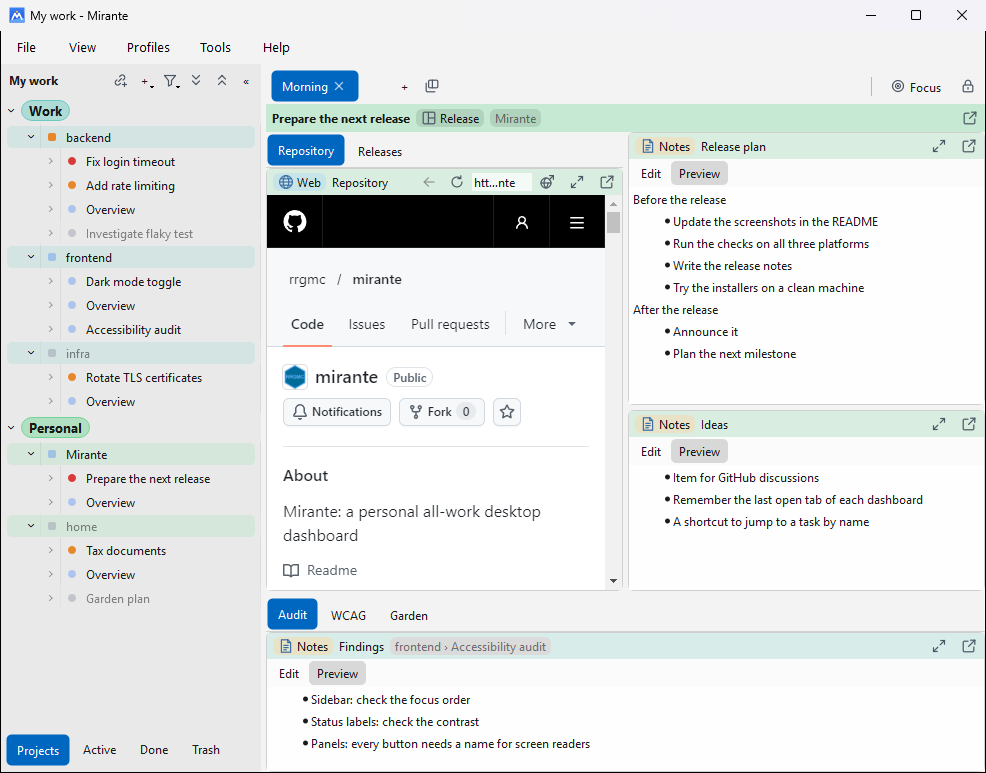

#  Mirante core

The core of [Mirante](https://github.com/rrgmc/mirante), a personal desktop dashboard for all of one person's work, in Qt 6 for Windows, macOS and Linux. It holds the app itself, the interface that modules use, the build, and the design documents. To use Mirante, download it from [its releases](https://github.com/rrgmc/mirante/releases).

## How Mirante is built

Mirante is split into repositories, and an app repository lists which of them to build:

| Repository | Holds |
|---|---|
| `mirante-core`, this one | The app, the module interface, the build, the reusable workflows, and the design documents |
| [`mirante-modules`](https://github.com/rrgmc/mirante-modules) | Documents, folders, images, notes and web pages |
| [`mirante-modules-work`](https://github.com/rrgmc/mirante-modules-work) | GitHub, GitLab, Jira and Claude |
| [`mirante`](https://github.com/rrgmc/mirante) | The official app: a manifest, `mirante.json`, that pins the core and both repositories of modules at their release tags |
| [`mirante-app-template`](https://github.com/rrgmc/mirante-app-template) | A template for a Mirante of your own, with the modules you choose |
| [`mirante-modules-samples`](https://github.com/rrgmc/mirante-modules-samples) | Small sample modules |

When an app configures, the core fetches the repositories that its manifest lists, at their pins, and compiles the listed modules into the app. Each repository releases on its own, with a tag `vX.Y.Z`. See [custom builds](docs/plans/custom-builds.md) and [decision 0116](docs/decisions/0116-custom-builds-in-separate-repositories.md).

## Why modules are compiled in

A module is a static library, linked into the app when it is built. Mirante does not load modules while it runs, as plugins or shared libraries:

- **macOS would refuse them.** The app is signed with a Developer ID and runs with the hardened runtime, which notarisation requires. The hardened runtime loads only libraries signed by the same team, or by Apple. A module built by someone else would not load, unless the app turned off that library check, which would weaken the protection that notarisation gives every user.
- **A plugin must match the app exactly.** It must be built with the same Qt version and the same compiler, for each platform and architecture, and the module interface would have to stay binary compatible from one release to the next.
- **A plugin is no safer.** It runs in the app's process, so it can read every token and crash the whole app, as a compiled-in module can. Qt cannot unload a plugin safely either.
- **Compiled in, the build checks everything at once.** A module that no longer fits the interface fails to build, in CI, before anyone installs it.

So a Mirante with other modules is a new build of Mirante, made from a manifest that lists them. The template makes that a repository and a few clicks on GitHub. See decisions [0013](docs/decisions/0013-compiled-in-modules.md) and [0121](docs/decisions/0121-modules-are-trusted-code.md).

## Documents

- [The design](docs/README.md), with its glossary
- [Modules](docs/modules.md), the contract between the core and the modules
- [Writing a module](docs/writing-a-module.md), a guide for authors outside the project
- [The decisions](docs/decisions/README.md)
- [The roadmap](docs/roadmap.md)
- [Building](BUILDING.md), and the [changelog](CHANGELOG.md)

## Author

Rangel Reale <realerangel@gmail.com>

## License

Released under the [MIT License](LICENSE).
